<div align="center">

<picture>
  <source media="(prefers-color-scheme: dark)" srcset="docs/readme/banner-dark.svg">
  
</picture>

<p>
  <a href="#run-on-a-mac"><b>Run on a Mac</b></a> ·
  <a href="#connect-an-esp32"><b>Connect an ESP32</b></a> ·
  <a href="#nodo-core-optional"><b>NODO Core</b></a> ·
  <a href="#roadmap"><b>Roadmap</b></a> ·
  <a href="docs/PROJECT.md"><b>Product spec</b></a>
</p>

</div>

**NODO** is an experimental, local-first maker dashboard for iPad. You build your own control surfaces for DIY electronics, from an ESP32 LED to a motorised curtain, and it grows towards a single place to control the whole home. The iPad works on its own for foreground control; a Raspberry Pi hub is optional.

<p align="center">
  
</p>

> [!WARNING]
> NODO is a **prototype**. The Bluetooth channel has no authenticated pairing or encrypted command channel yet, so a nearby BLE client can send commands. Don't use it with locks, alarms, high-voltage relays, heaters, safety systems or unattended motors.

<picture>
  <source media="(prefers-color-scheme: dark)" srcset="docs/readme/features-dark.svg">
  
</picture>

## Run on a Mac

Install [Xcode](https://developer.apple.com/xcode/) and [XcodeGen](https://github.com/yonaskolb/XcodeGen), then:

```bash
cd native
xcodegen generate
open NODO.xcodeproj
```

Pick an iPad simulator and press **⌘R**. Demo mode needs no server, no ESP32 and no cloud account.

**What's in the app today**

- **Dashboard Studio:** named dashboards, each with its own light or dark theme, accent colour and number of columns; widgets one, two or three columns wide, with visibility toggles. Drag a widget onto another to reorder it, in Studio or on the dashboard.
- **Widget engine:** slider, button, joystick, gauge and chart widgets per dashboard, with saved settings and optional device binding. Chart data is for demonstration and the joystick is single-axis for now.
- **Local persistence:** dashboards and device snapshots are saved on the iPad, with migration from earlier versions.

The canvas is column-based: free pixel positioning, free resizing and custom widget authoring are planned.

## Connect an ESP32

Bluetooth needs a **physical iPad**: scanning in the simulator isn't enough. The full walkthrough is in the [M1 hardware guide](docs/M1-HARDWARE.md); in short:

1. In the Arduino IDE, install the **Espressif Arduino-ESP32 boards package (3.x)** and choose your ESP32-S3 target.
2. Open `firmware/esp32-nodo-ble-switch/esp32-nodo-ble-switch.ino`. Connect an LED **with a suitable series resistor** to a safe GPIO and GND, and set `OUTPUT_PIN` to match. Check your board's schematic first: on some Freenove boards GPIO2 is already in use.
3. Upload the sketch. The Serial Monitor (115200) shows `NODO M1 BLE switch advertising`.
4. Run NODO on the iPad, enable Bluetooth and grant permission, then tap **Add device → Scan for NODO devices → NODO ESP32 Demo**.
5. Back on Home, an `ESP32 Demo LED` switch appears. Toggle it: the GPIO follows, and the state comes back over BLE notify/read.
6. Cut the power and the card turns **Offline**. After a reboot, reconnect through **Add device**.

**The protocol** is a small JSON-over-GATT draft (`nodo/1`) with a manifest, a state characteristic and a command characteristic. UUIDs, payloads and size limits are in [docs/BLE-PROTOCOL.md](docs/BLE-PROTOCOL.md); the app side is in `native/NODO/Services/BLEManager.swift`. Read-back state is authoritative: a write acknowledgment only confirms the transport, not that anything moved.

The `firmware/esp32-curtains` sketch is a second example: a curtain on a stepper driver with two limit switches, controlled over Wi-Fi and MQTT through NODO Core. Calibrate it before trusting positions, and keep the mechanism attended while commissioning.

## NODO Core (optional)

An optional Python hub for always-on control: a FastAPI server with SQLite storage, MQTT (Mosquitto), automations, a WebSocket feed and a browser dashboard. It is maintained separately from the iPad app, which never needs it.

1. Create a `.env` file next to `docker-compose.yml` with `NODO_TOKEN` (protects the API and WebSocket when set), `NODO_MQTT_USER` and `NODO_MQTT_PASS`.
2. The broker refuses anonymous clients, so create its password file at `mosquitto/config/passwords` with the same credentials, plus one for each device.
3. Start everything:

```bash
docker compose up -d    # Mosquitto on 127.0.0.1:1883, NODO Core on :8080
```

Or run the hub directly with `pip install -r requirements.txt` and `uvicorn core.app:app --host 0.0.0.0 --port 8080`.

## Project layout

```text
native/      SwiftUI iPad app: dashboards, widgets, CoreBluetooth
core/        optional Python hub (FastAPI, SQLite, MQTT)
web/         browser dashboard served by the hub
firmware/    example ESP32 peripherals (BLE switch, MQTT curtain)
mosquitto/   MQTT broker configuration
docs/        product spec, hardware guide, BLE protocol
```

## Roadmap

| Milestone | Scope |
| --- | --- |
| **M0** ✓ | Native shell, sample dashboard, local persistence, BLE scan/connect/JSON GATT |
| **M1** | Production BLE fragmentation and reassembly, reference firmware, manifest validation, identity challenge and approval, state sync, tests on a physical iPad |
| **M2** | Wi-Fi discovery with Bonjour and signed local pairing, HTTP/WebSocket adapters, a Raspberry Pi device profile |
| **M3** | Drag and drop, resizing, themes, rooms, import/export, live preview, accessibility |
| **M4** | Matter and selected commercial integrations, verified on supported accessories |
| **M5** | Device-owned local automation, optional Core orchestration, secure upgrades, beta testing |

Parts of M1, M3 and M4 are already in the app (see above). **Not goals for the first release:** universal control of arbitrary Bluetooth devices, firmware flashing from the iPad, cloud accounts, a background server on the iPad, or mains hardware certification. The design rules behind all of this are in the [product spec](docs/PROJECT.md).

## Contributing

Issues are welcome. Include the device model, firmware version, iPadOS version and exact steps to reproduce.

> [!CAUTION]
> Never commit pairing credentials, Wi-Fi secrets or local `.env` files.

## License

MIT. See [LICENSE](LICENSE).

---

<sub>Made by <a href="https://github.com/gabrielevierti">Gabriele Vierti</a> in Milan.</sub>
